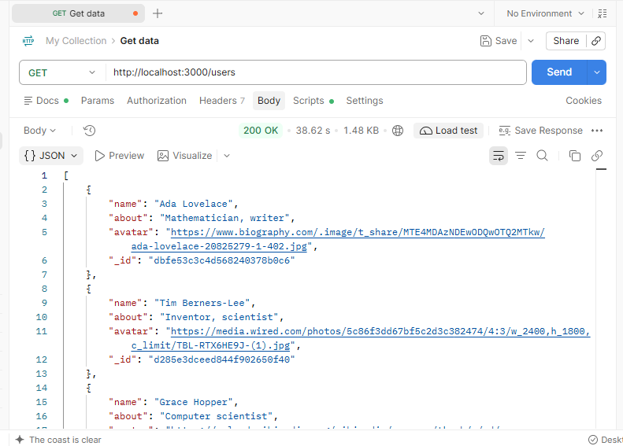
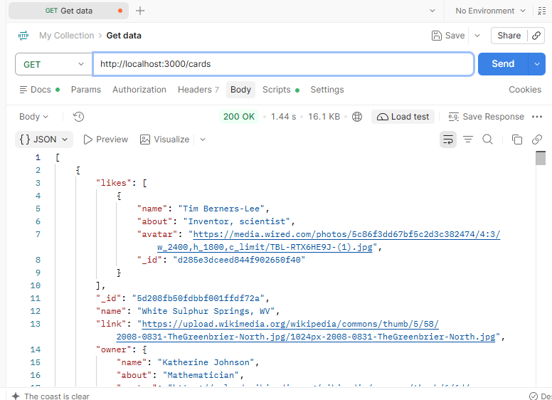
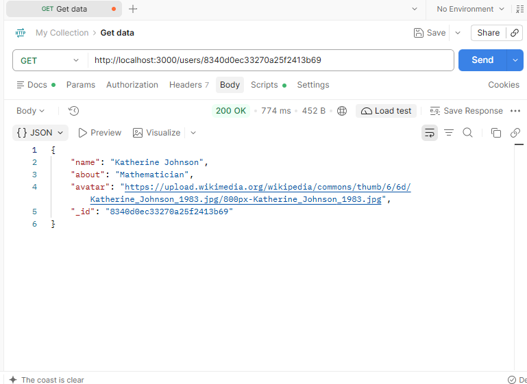
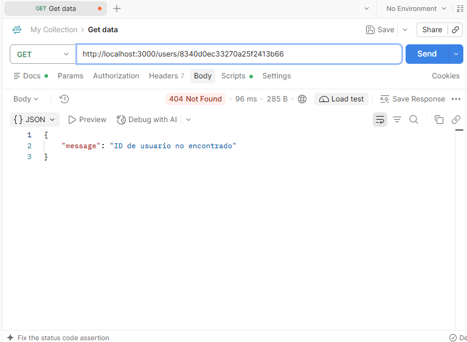
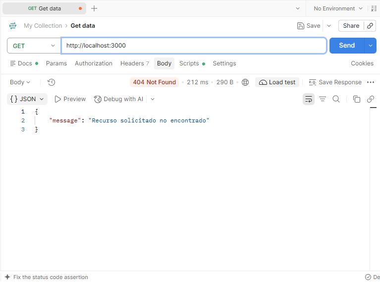

# Tripleten web_project_around_express

#  Descripción del proyecto

Web Project Around Express es una API REST desarrollada con Node.js y Express.js. Permite consultar información de usuarios y tarjetas almacenada en archivos JSON, así como buscar un usuario específico mediante su identificador único (_id).

La aplicación utiliza una estructura modular que separa las rutas de los archivos de datos. Además, implementa el manejo de errores mediante códigos de estado HTTP para responder adecuadamente cuando un usuario no existe, se solicita una ruta desconocida o ocurre un error durante la lectura de los archivos.

Funcionalidades principales

Consultar la lista completa de usuarios.

Consultar la lista completa de tarjetas.

Buscar un usuario específico mediante su ID.

Gestionar solicitudes a usuarios inexistentes y rutas desconocidas mediante respuestas HTTP 404.

Gestionar errores de lectura de archivos mediante respuestas HTTP 500.

##  Tecnologías y técnicas utilizadas

- Node.js: entorno de ejecución de JavaScript utilizado para desarrollar la aplicación del lado del servidor.

- Express.js: framework utilizado para crear el servidor HTTP y definir las rutas de la API.

- JavaScript (CommonJS): utilizado para implementar la lógica de la aplicación y organizar sus módulos.

- Módulo fs de Node.js: utilizado para leer archivos JSON de forma asíncrona mediante fs.readFile().

- Módulo path de Node.js: utilizado para construir rutas de archivos mediante path.join().

- JSON: formato utilizado para almacenar los datos de usuarios y tarjetas.

- Códigos de estado HTTP: utilizados para indicar el resultado de las solicitudes y comunicar errores.

- ESLint: herramienta utilizada para verificar la calidad y consistencia del código.

### Endpoints de la API

Método HTTP       Endpoint         Descripción

GET               /users         Devuelve la lista completa de usuarios.

GET               /cards         Devuelve la lista completa de tarjetas.

GET               /users/:_id    Devuelve los datos de un usuario específico mediante su ID.

Manejo de errores:

404 Not Found: se devuelve cuando el usuario solicitado no existe o cuando la ruta solicitada no está definida.

500 Internal Server Error: se devuelve cuando ocurre un error interno al leer un archivo JSON.

### Evidencias de funcionamiento

### Consulta de usuarios

### Consulta de tarjetas

### Consulta de usuario por ID

### Usuario no encontrado

### Ruta no encontrada

